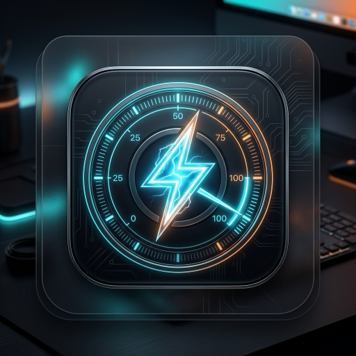

<p align="center">
  
</p>

<h1 align="center">⚡ Mac Dictator</h1>

<p align="center">
  <strong>Hardware Power Governor & Wattage Limiter for macOS (Apple Silicon)</strong><br>
  <em>Strictly enforce hardware power ceilings (e.g. 1W, 3W, 5W, 10W) on Apple Silicon CPU & GPU.</em>
</p>

<p align="center">
  
  
  
  
</p>

---

## 💡 The Problem

On traditional x86 computers, tools like *ThrottleStop* or Intel XTU allowed direct hardware TDP and undervolt clamping. On **Apple Silicon (M1, M2, M3, M4, M5)**, dynamic voltage and frequency scaling (DVFS) is managed completely inside hardware firmware. Unchecked background tasks, AI rendering, rogue processes, or build tools can spike power draw to 30W–60W+, draining battery life and heating up your machine.

**Mac Dictator** solves this. It is a lightweight native macOS background application and CLI daemon that monitors real-time component wattage and enforces hard power limits using a closed-loop feedback governor.

---

## ✨ Features

- **⚡ Instantaneous Hardware Telemetry (500ms)**:
  - Direct hardware energy reading via macOS private `libIOReport.dylib` Energy Model (no root required).
  - Cluster Mach ticks across Super/Performance and Efficiency cores.
  - Live display backlight telemetry via `DisplayServicesGetBrightness`.
  - Sub-second sampling with minimal footprint (< 0.2% CPU, ~50 MB RAM).

- **🛑 Strict Closed-Loop Power Ceilings**:
  - Independent or combined wattage limits for **CPU Power** (0.5W – 25W) and **GPU Power** (0.5W – 20W).
  - Quick-preset pills: `1W (Ultra-Eco / Emergency Battery Saver)`, `3W (Low)`, `5W (Balanced)`, `10W (High)`, `15W`.
  - Multi-tiered governor enforcement:
    1. **E-Core Migration**: Automatically demotes runaway compute threads to high-efficiency E-cores (`PRIO_DARWIN_BG`).
    2. **Microsecond Duty-Cycling**: Enforces interleaved `SIGSTOP`/`SIGCONT` duty-cycle slicing to clamp compute power below your target.
    3. **Low Power Mode Coordination**: Dynamically requests macOS system Low Power Mode during sustained surges.

- **🔋 Dual Telemetry Modes (`LIVE` vs `GAUGE`)**:
  - **`LIVE` Mode**: Real-time 500ms zero-latency hybrid telemetry that immediately reacts to screen brightness adjustments and compute load.
  - **`GAUGE` Mode**: 100% direct chemical coulometer reading from the physical Texas Instruments `bq40z651` gas gauge on the battery connector (updated every 60s by Apple PMU firmware).
  - Click the **TOTAL** card anytime to toggle between modes!

- **📌 Pin Overlay (Always on Top)**:
  - Click the pin icon in the top header to keep the popover floating above all apps without auto-dismissing when you switch windows.

- **📊 30-Second Rolling History Sparkline**:
  - Compact graph showing real-time CPU (Cyan) and GPU (Purple) power curves against your red dashed wattage ceiling.

- **🛡️ Process Inspector & Exemption Whitelist**:
  - View top consuming processes with instant estimated wattage.
  - One-click shield button to exempt mission-critical applications (e.g. your audio player, IDE, or terminal) from being throttled.
  - Core system services (`WindowServer`, `launchd`, `loginwindow`) are protected by default to guarantee buttery-smooth 120Hz ProMotion UI.

- **🔥 Verification & Stress Lab**:
  - Built-in multi-threaded synthetic CPU burner (1 to 18 threads).
  - Visually verify your power limits: watch uncapped draw surge to 30W+, then toggle the governor ON and watch the power curve immediately flatten below your cap!

- **💻 Dual Interface**:
  - Native Menu Bar App (`Mac Dictator.app`): Sits quietly in the top bar displaying live battery draw (e.g. `🔋 4.8W` or `⚠️ 5.2W [Cap 5W]`).
  - Terminal CLI Tool (`mac-dictator-cli`): Full-featured command-line dashboard and daemon for terminal power users.

---

## 🏗️ Architecture & Governor Flow

```
┌────────────────────────────────────────────────────────┐
│            Real-Time Hardware Telemetry (500ms)        │
│   • libIOReport Energy Model (GPU Watts)               │
│   • Mach Processor Ticks (P-Core & E-Core Load)        │
│   • DisplayServices (Live Backlight & Panel Power)     │
│   • AppleSmartBattery (60s Ground-Truth Gas Gauge)     │
└──────────────────────────┬─────────────────────────────┘
                           │
                           ▼
          Power Exceeds Target Wattage Limit?
             /                           \
           YES                            NO
           /                                \
┌─────────────────────────┐      ┌─────────────────────────┐
│ Active Governor Clamp   │      │ Smooth Budget Recovery  │
│ 1. Demote to E-cores    │      │ 1. Restore normal QoS   │
│    (PRIO_DARWIN_BG)     │      │ 2. Relax duty cycles    │
│ 2. Duty-Cycle Slicing   │      │ 3. Deactivate low-power │
│    (SIGSTOP / SIGCONT)  │      │    mode                 │
│ 3. Coordinate LPM       │      └─────────────────────────┘
└─────────────────────────┘
```

---

## 📋 Requirements

- **Mac**: Apple Silicon (M1, M2, M3, M4, M5, Pro, Max, Ultra)
- **Operating System**: macOS 13.0 (Ventura), macOS 14.0 (Sonoma), macOS 15.0+ (Sequoia)
- **Toolchain**: Xcode 15+ or Command Line Tools (`swift --version` >= 5.9)

---

## 🚀 Quick Start

### 1. Build and Run the App

Clone the repository and run the build script:

```bash
git clone https://github.com/nimishnmn/Mac-Dictator.git
cd Mac-Dictator

# Build release binary and package Mac Dictator.app
./Scripts/build_app.sh

# Launch the app
open "Mac Dictator.app"
```

Look for the `⚡` / `🔋` power icon in your macOS status bar!

### 2. Run in Terminal (CLI Mode)

```bash
# Build the CLI tool
swift build -c release

# Monitor power with a 5W CPU cap and 3W GPU cap
.build/release/mac-dictator-cli --cpu 5.0 --gpu 3.0 --on

# Test power capping under synthetic stress load
.build/release/mac-dictator-cli --cpu 5.0 --stress --on
```

### 3. Launch Automatically on Login (Optional)

To have Mac Dictator run silently in the background whenever you log into macOS:

```bash
./Scripts/install_service.sh
launchctl load ~/Library/LaunchAgents/com.macdictator.agent.plist
```

To uninstall the background service:

```bash
launchctl unload ~/Library/LaunchAgents/com.macdictator.agent.plist
rm ~/Library/LaunchAgents/com.macdictator.agent.plist
```

---

## 🛠️ Project Structure

```text
├── Package.swift               # Swift Package Manager manifest
├── README.md                   # Project documentation
├── LICENSE                     # MIT License
├── Resources/
│   ├── AppIcon.icns            # macOS application icon bundle
│   └── AppIcon.png             # Hi-res application icon
├── Scripts/
│   ├── build_app.sh            # Release build, packaging & codesigning script
│   └── install_service.sh      # LaunchAgent generator for auto-start
└── Sources/
    ├── MacDictatorCore/        # Core telemetry, hardware detection & governor engine
    │   ├── Hardware/           # Apple Silicon chip detection & core cluster specs
    │   ├── Models/             # Power readings and configuration data structures
    │   ├── Telemetry/          # libIOReport, Mach ticks, battery & display monitors
    │   ├── Governor/           # Process throttler, E-core clamp & QoS migration
    │   └── Stress/             # Multi-core synthetic workload generator
    ├── MacDictatorApp/         # SwiftUI menu bar UI, popover controller & AppKit delegate
    │   ├── Views/              # Gauges, sparklines, sliders, and process list
    │   └── AppDelegate.swift   # NSStatusItem, NSPopover & floating window management
    └── MacDictatorCLI/         # Terminal CLI entry point
```

---

## 🤝 Contributing

Contributions, bug reports, and pull requests are warmly welcome!

1. Fork the Project
2. Create your Feature Branch (`git checkout -b feature/AmazingFeature`)
3. Commit your Changes (`git commit -m 'Add some AmazingFeature'`)
4. Push to the Branch (`git push origin feature/AmazingFeature`)
5. Open a Pull Request

---

## 📄 License

Distributed under the **MIT License**. See [`LICENSE`](LICENSE) for more information.

<p align="center">
  Crafted with care for Apple Silicon by <strong><a href="https://github.com/nimishnmn">Nimish Naman</a></strong>
</p>
